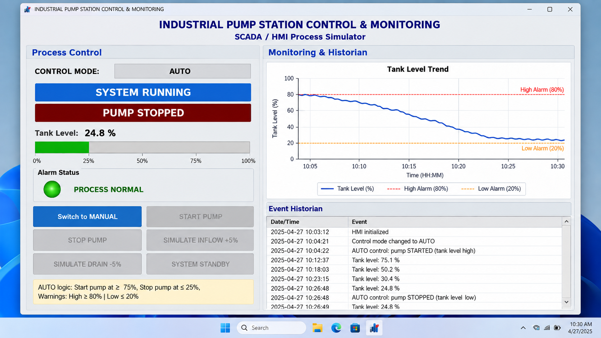
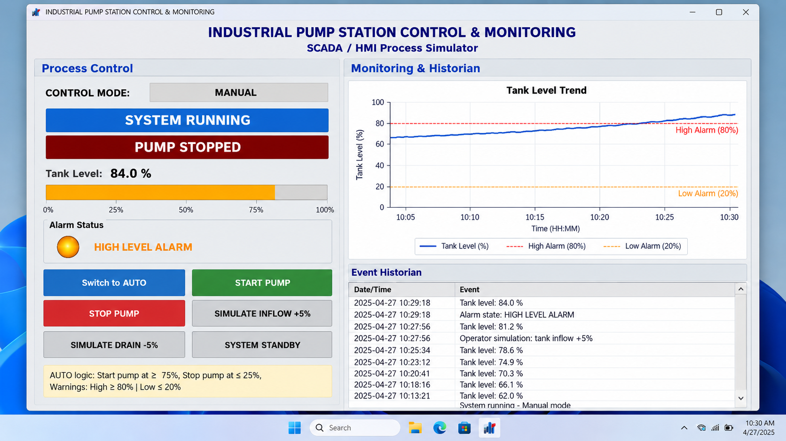
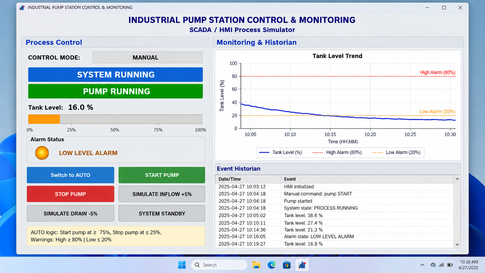
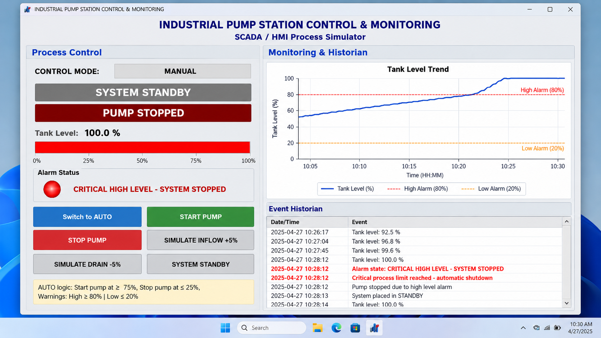

# Industrial Pump Station Control & Monitoring System

**Pradip Sapkota**

A desktop SCADA/HMI simulator for an industrial pump station and storage tank. The project models tank level, pump control, alarm handling, operator interlocks, automatic level regulation, event history, and real-time process trending.

This repository contains an original English implementation written for my industrial controls portfolio.

## Features

### Process Simulation
- Simulated storage-tank level from 0% to 100%
- Continuous process inflow
- Pump-controlled discharge
- One-second process scan cycle
- Automatic shutdown at critical process limits

### Manual Control
- Start and stop pump commands
- Manual inflow and drain test controls
- Operator-command interlocks
- System standby control

### Automatic Control
- Automatic pump start at **75%**
- Automatic pump stop at **25%**
- Manual controls disabled while AUTO mode is active
- Hysteresis between start/stop thresholds to prevent rapid cycling

### Alarm Management

| Process Condition | Alarm State | Response |
|---|---|---|
| 20% < Level < 80% | Normal | Green indicator |
| Level ≤ 20% | Low-level warning | Orange indicator |
| Level ≥ 80% | High-level warning | Orange indicator |
| Level = 0% | Critical low | Red flashing alarm + shutdown |
| Level = 100% | Critical high | Red flashing alarm + shutdown |

### HMI / SCADA Functions
- Tank-level percentage display
- Dynamic level bar
- Pump RUNNING / STOPPED indication
- MANUAL / AUTO mode indication
- Alarm annunciation
- Flashing critical alarm lamp
- Real-time trend graph
- Timestamped event historian
- Duplicate-event suppression

## Control Philosophy

The simulator uses a simple automatic level-control strategy:

```text
Level >= 75%
     |
     v
START PUMP
     |
     v
Tank level decreases
     |
     v
Level <= 25%
     |
     v
STOP PUMP
     |
     v
Tank level rises from process inflow
```

The 25% / 75% control band stays inside the 20% / 80% alarm boundaries so normal automatic operation has margin before an alarm condition.

## Software Architecture

The application is separated into process, alarm, historian, and HMI layers:

```text
Industrial_Pump_Station_SCADA/
├── README.md
├── LICENSE
├── requirements.txt
├── .gitignore
│
├── src/
│   ├── main.py
│   ├── process.py
│   ├── alarms.py
│   └── historian.py
│
├── docs/
│   ├── CONTROL_PHILOSOPHY.md
│   └── I_O_AND_TAGS.md
│
└── screenshots/
    └── README.md
```

### `process.py`
Contains the simulated pump-station process, control mode, pump state, setpoints, interlocks, and automatic-control logic.

### `alarms.py`
Evaluates level conditions and returns NORMAL, WARNING, or CRITICAL alarm states.

### `historian.py`
Stores level-trend samples and timestamped events.

### `main.py`
Builds the Tkinter HMI and coordinates process updates, alarms, trends, and operator commands.

## Installation

### Requirements
- Python 3.10+
- Tkinter
- Matplotlib

Install Python dependencies:

```bash
pip install -r requirements.txt
```

Tkinter is included with many Python installations. On Linux it may need to be installed through the system package manager.

## Run

From the repository root:

```bash
python src/main.py
```

## Operator Guide

### Manual Mode

1. Launch the application.
2. Use **START PUMP** to run the discharge pump.
3. Use **STOP PUMP** to stop it.
4. Use the inflow/drain test buttons to simulate process disturbances.
5. Observe the alarm indicator, trend, and event log.

### Automatic Mode

1. Select **Switch to AUTO**.
2. The controller starts the pump when level reaches 75%.
3. The controller stops the pump when level falls to 25%.
4. Manual pump/process buttons are disabled while AUTO is active.
5. Return to MANUAL to restore operator control.

## Industrial Controls Concepts Demonstrated

- SCADA/HMI design
- Automatic and manual operating modes
- Process interlocks
- Alarm annunciation
- Event historian
- Analog process variable trending
- Start/stop control
- Setpoint-based control
- Hysteresis
- Fail-safe process shutdown
- PLC-style cyclic execution concepts

## Broader Project Context

This Python application represents the software simulation/HMI portion of an industrial pump-station control project. The control philosophy is intentionally structured like a PLC/SCADA application so the process variables, equipment states, alarms, and operator commands can be mapped to PLC tags and industrial HMI objects.

See:

- [`docs/CONTROL_PHILOSOPHY.md`](docs/CONTROL_PHILOSOPHY.md)
- [`docs/I_O_AND_TAGS.md`](docs/I_O_AND_TAGS.md)

## Screenshots

Portfolio screenshots are included in `screenshots/` to show representative HMI operating states.

### Normal Operation



### High-Level Alarm



### Low-Level Alarm



### Critical Shutdown



These screenshots illustrate the intended simulator behavior for portfolio/demo purposes.

## Author

**Pradip Sapkota**  
Computer Engineering  
Minnesota State University, Mankato

## License

This project is released under the MIT License.
